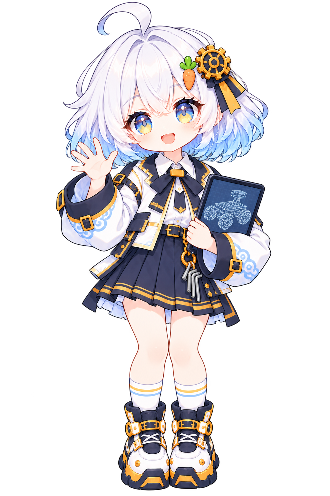
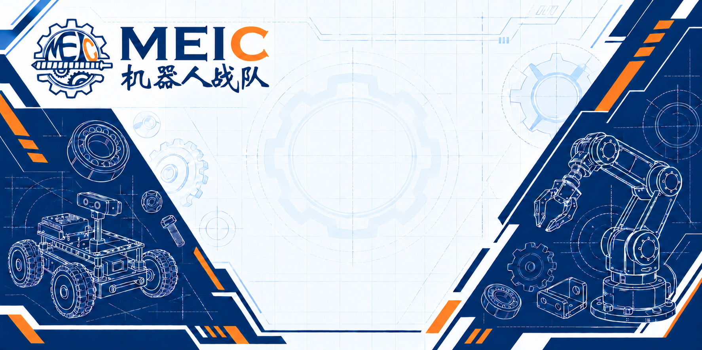
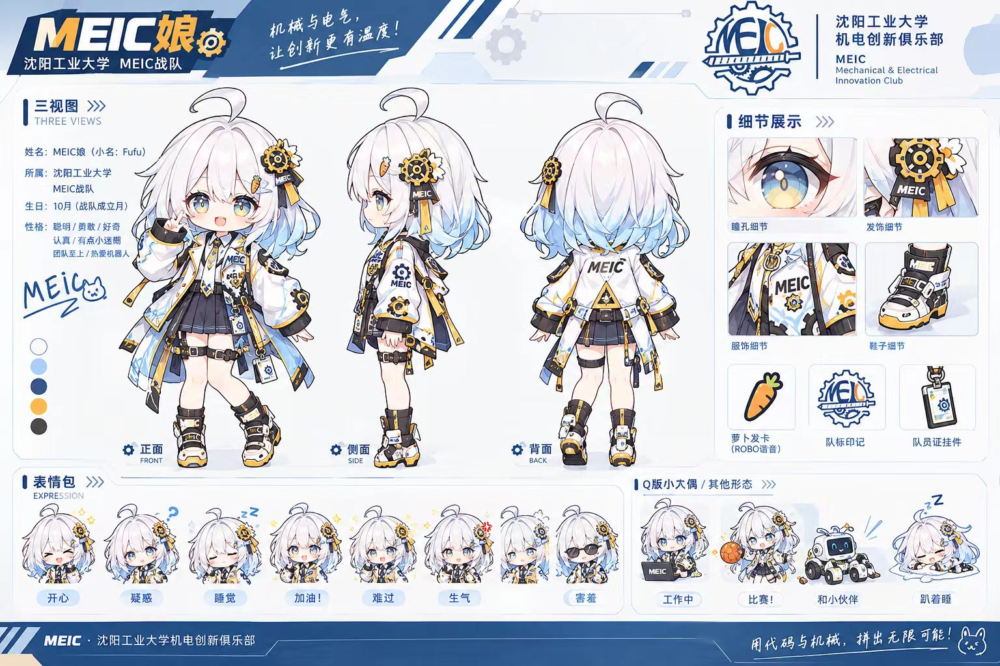
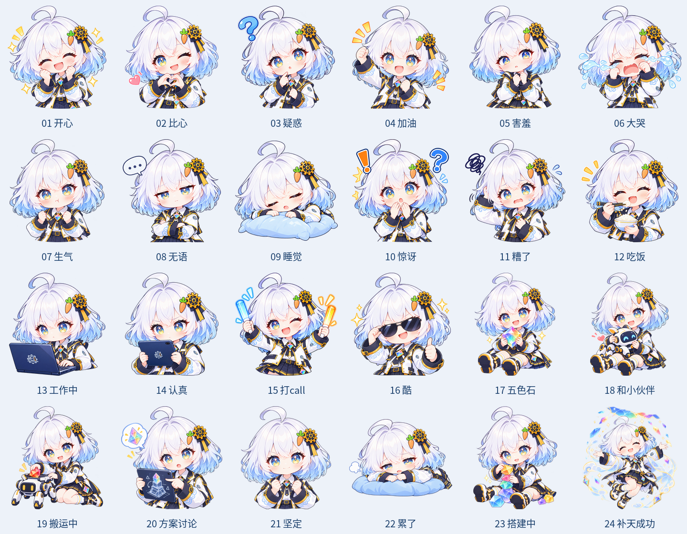

# 苏苏 susu · V2 / 战队立牌

当前形象去除服装队标，电脑 A 面及平板背面保留简化队标；方案讨论展示正面屏幕工程图。主题插画为日耀权杖与弓。

初稿、V1、V2 三个历史提交使用一致的目录结构；旧版通过提交历史或 `initial`、`v1`、`v2` 标签查看。当前新增战队宣传用立牌素材，只保留选定成品，本次未采用方案和调整记录不收录。仓库不包含压缩包。

| 目录 | 内容 |
| --- | --- |
| 发布素材 | 上传用表情、宣传图及介绍 |
| 高清原图/角色设定 | 标准角色与补天形态 |
| 高清原图/表情包 | 表情高清图，与上传文件同名 |
| 高清原图/宣传图 | 横幅、封面和图标原图 |
| 高清原图/主题插画 | 当时的主题插画 |
| 高清原图/立牌周边 | 战队宣传用透明底角色与 2:1 背景 |
| 提示词与说明 | 角色、表情、主题和修订说明 |
| 过程稿 | 早期不同尝试及提示词，供参考 |
| 队标素材 | 正式队标、简化队标与原始文字标识 |

## 战队立牌素材

| 文件 | 规格 | 用途 |
| --- | --- | --- |
| [苏苏角色](高清原图/立牌周边/苏苏-立牌角色.png) | 1024 × 1536，透明 PNG | 角色立牌图 |
| [配套背景](高清原图/立牌周边/苏苏-配套背景-2比1.png) | 1774 × 887，宽高 2:1 | 横版背景图 |
| [原始文字标识](队标素材/MEIC-文字（透明）.png) | 原文件存档 | MEIC / 机器人战队品牌文字 |

角色采用工程主题；背景采用最后一次微调后选定的第二张。可从以下预览直接检查。

[立牌素材与制作说明](提示词与说明/立牌周边.txt)

当前文件为插画素材，刀模线、白墨层、出血、底座和插榫需按实际尺寸与工艺制作。

## 既有角色与表情

既有素材来源：聊天「优化 MEIC 娘初稿」。立牌素材于 2026-11-02 使用内置 image_gen 生成及编辑，文字参考用户提供的 MEIC 机器人战队标识。未附加开源许可证，使用角色和标识需另行确认授权。
