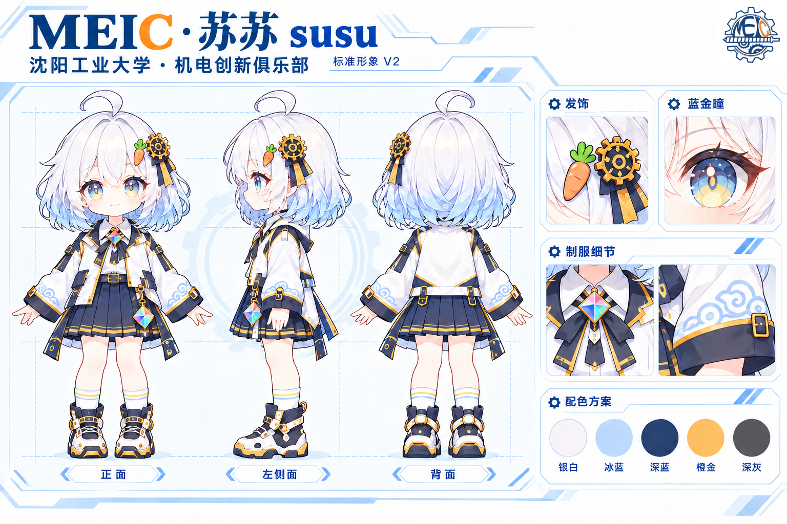
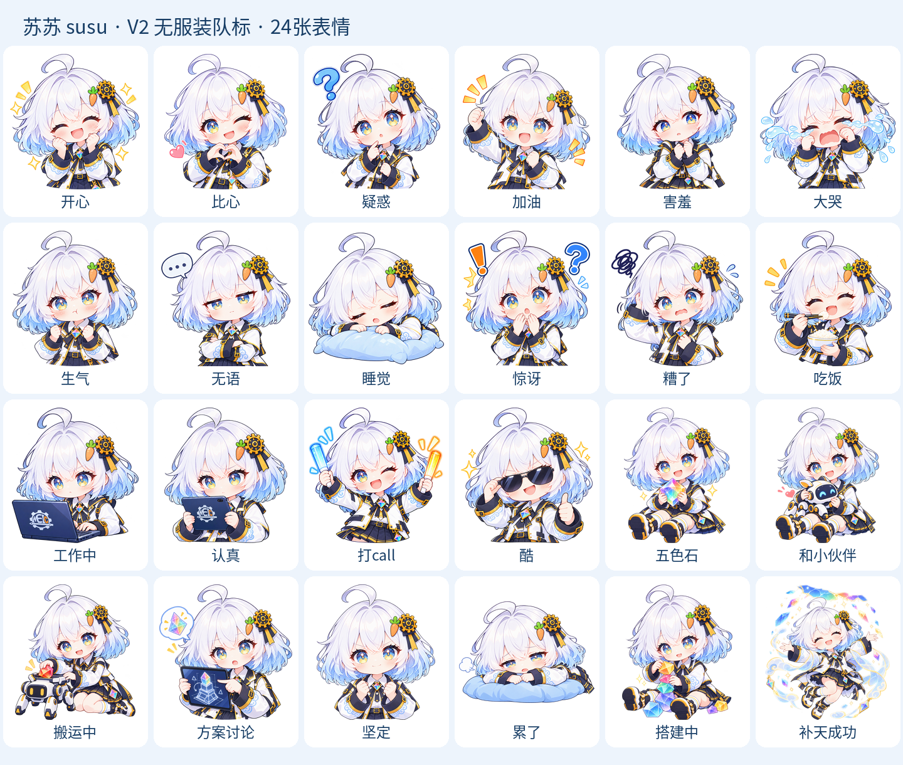

# 苏苏 susu · V2

当前形象去除服装队标，电脑 A 面及平板背面保留简化队标；方案讨论展示正面屏幕工程图。主题插画为日耀权杖与弓。

目录结构在三个提交中保持一致，通用文件名不带版本号。V1 和 V2 使用相同文件路径，更新时直接替换内容；旧版通过提交历史或 `initial`、`v1`、`v2` 标签查看。仓库不包含压缩包。

| 目录 | 内容 |
| --- | --- |
| 发布素材 | 上传用表情、宣传图及介绍 |
| 高清原图/角色设定 | 标准角色与补天形态 |
| 高清原图/表情包 | 表情高清图，与上传文件同名 |
| 高清原图/宣传图 | 横幅、封面和图标原图 |
| 高清原图/主题插画 | 当时的主题插画 |
| 提示词与说明 | 角色、表情、主题和修订说明 |
| 过程稿 | 早期不同尝试及提示词，供参考 |
| 队标素材 | 正式队标与简化队标 |

素材来源：聊天「优化 MEIC 娘初稿」。本次不重新绘图，未附加开源许可证，使用角色和标识需另行确认授权。
