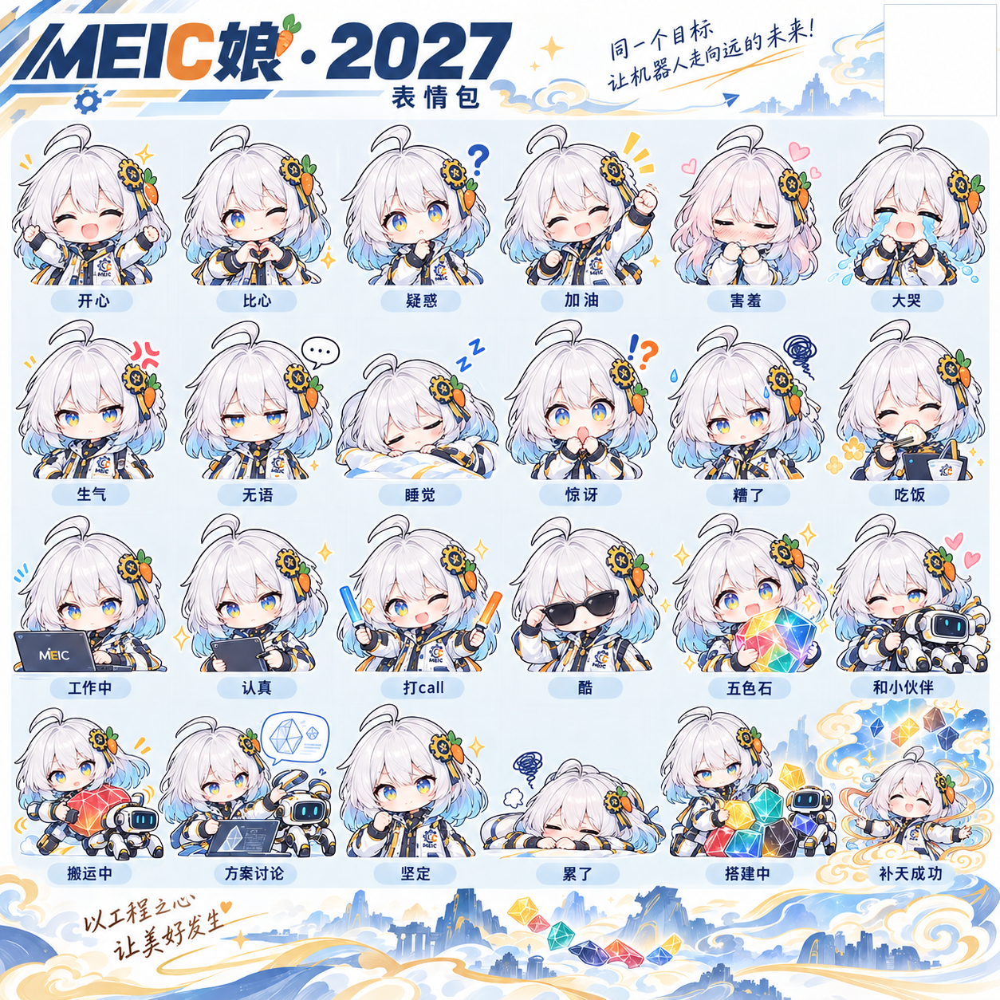
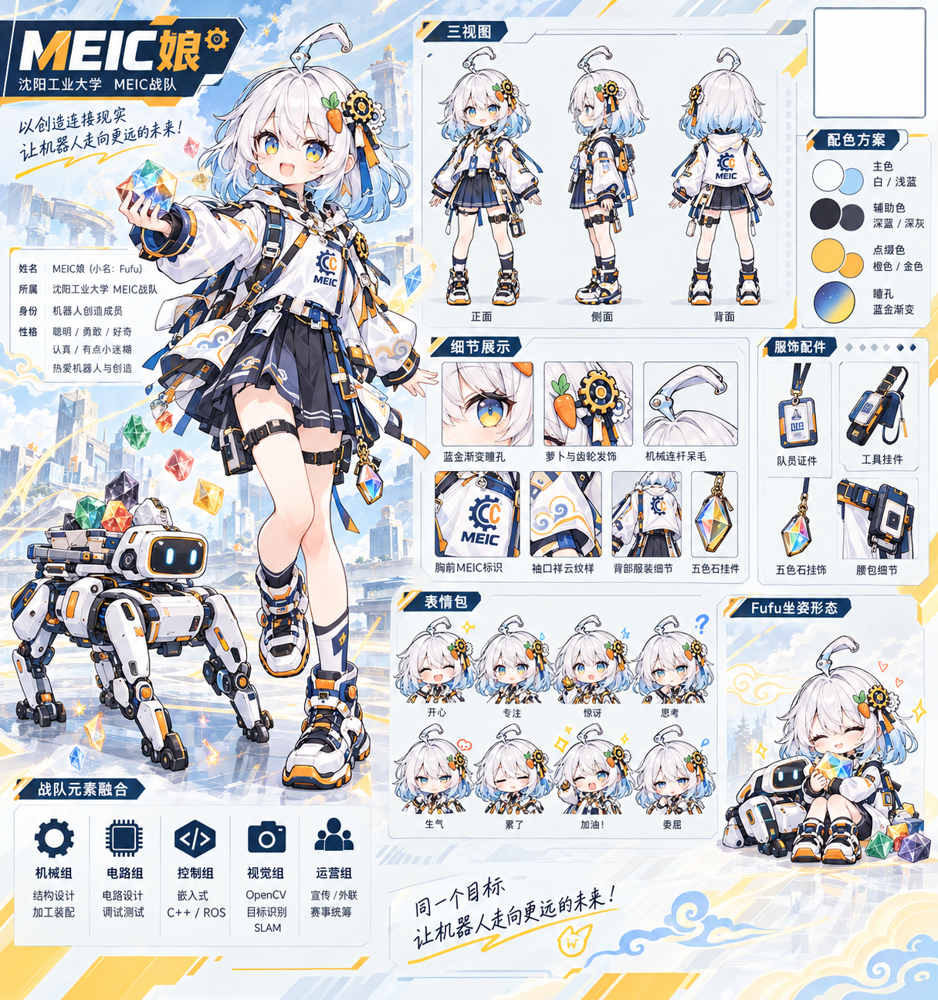
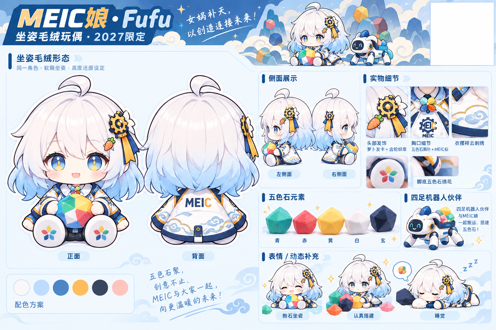
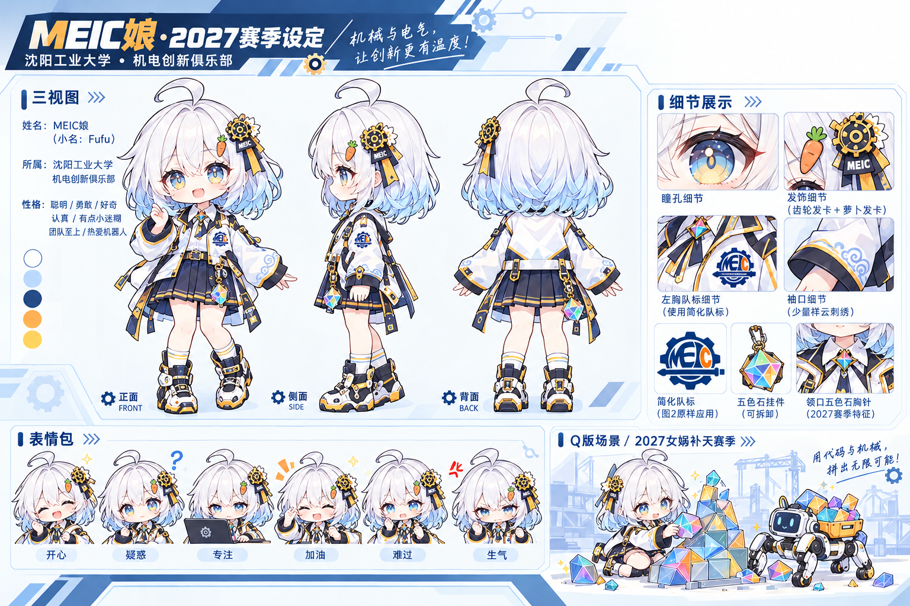
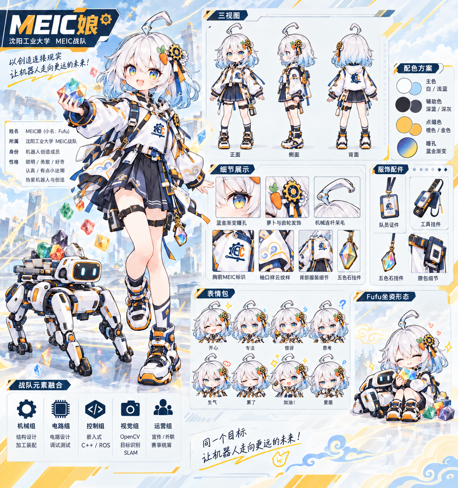
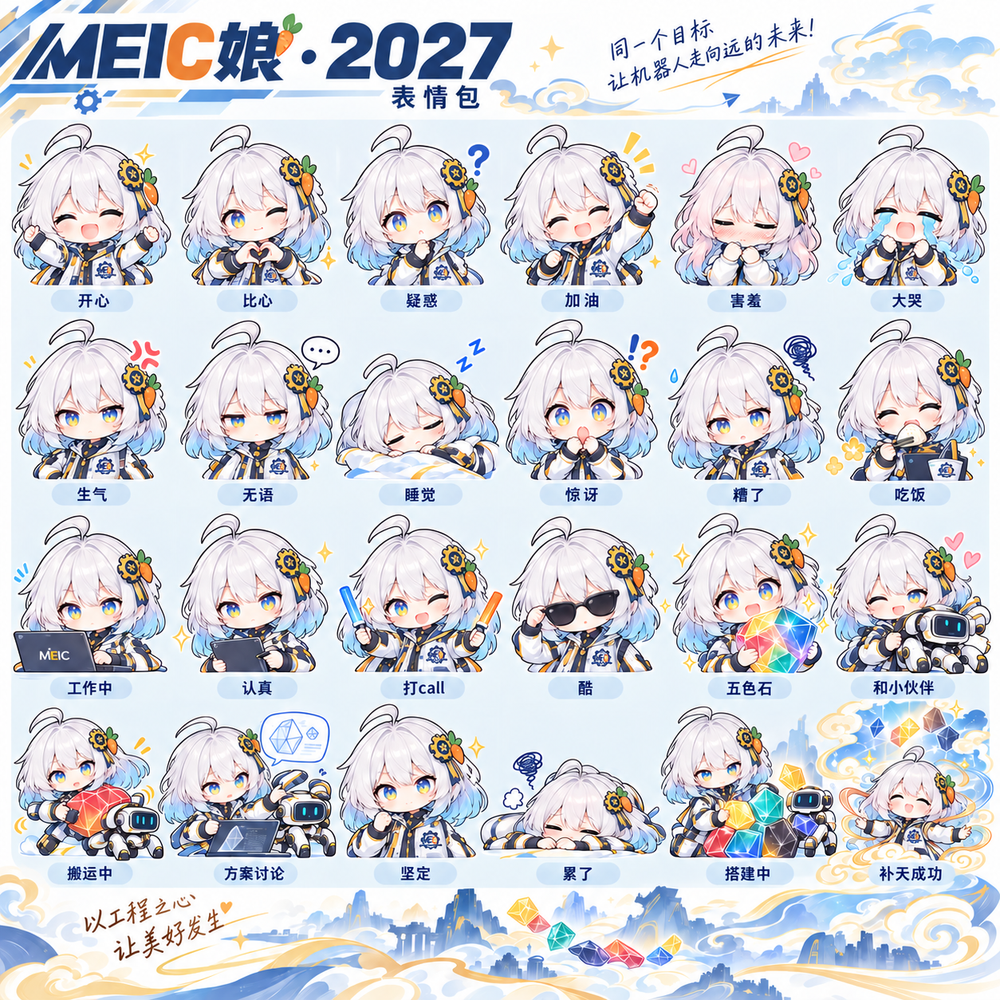
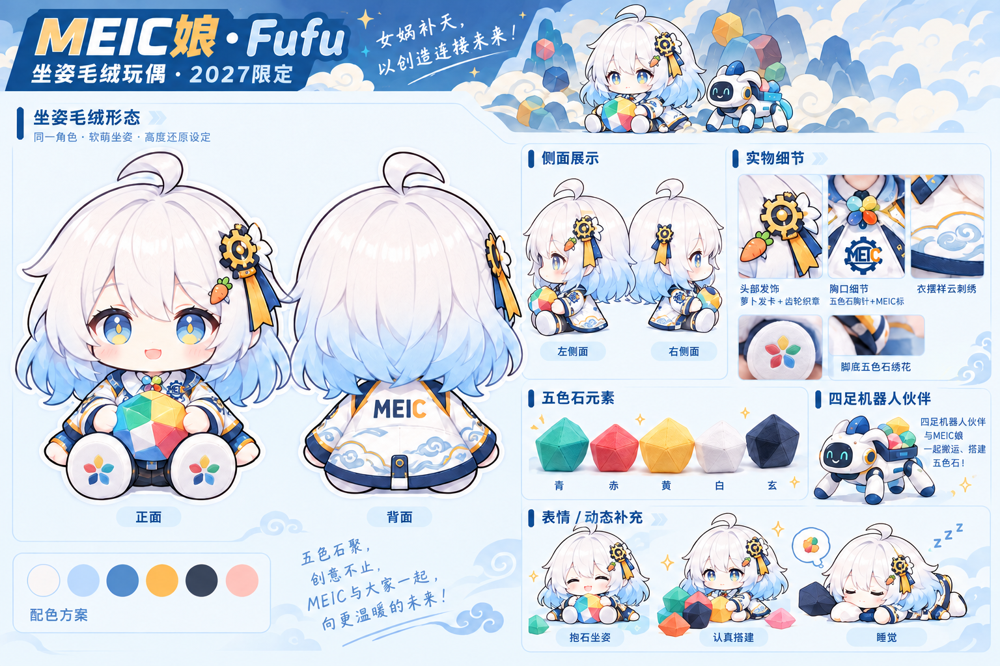
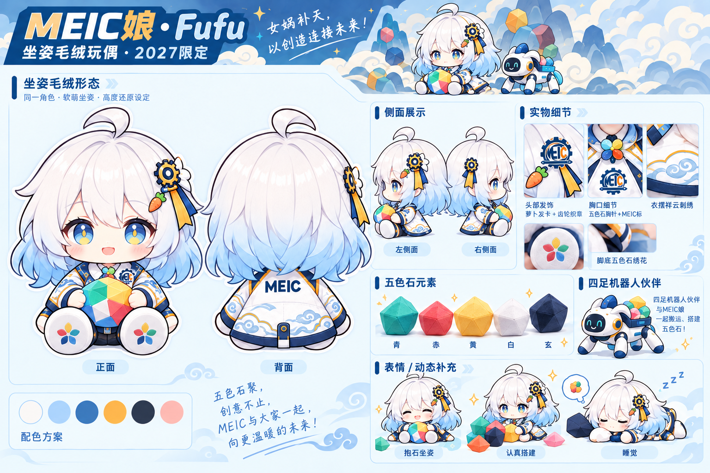
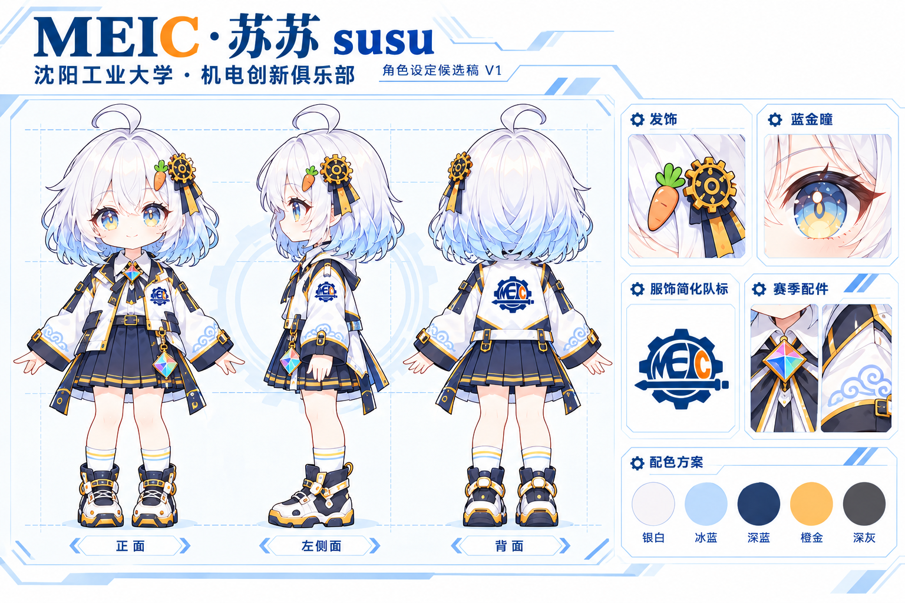

# 早期过程稿（参考）

保存该阶段生成且与已归档成品字节不同的图片，包括未采用、待修正和继续加工前的原始图。归档不表示通过视觉确认。点击图片看原图，文件名按 UTC 生成时间排列（北京时间加 8 小时）。

| 编号 | 预览 | 生成提示词节选 |
| --- | --- | --- |
| 01 |  | Use case: precise-object-edit. 编辑图1，图2是权威队标参考。保持图1角色身份、面容、发型、银白到冰蓝发梢、蓝金瞳孔、动漫线稿精致程度和原图主版式，优化成统一系列MEIC… [完整提示词](2026-10-23-121513-aad7e795.txt) |
| 02 |  | Use case: precise-object-edit. 编辑图1，图2是权威队标参考。保持图1角色身份、面容、发型、银白到冰蓝发梢、蓝金瞳孔、动漫线稿精致程度和原图主版式，优化成统一系列MEIC… [完整提示词](2026-10-23-121809-5f474070.txt) |
| 03 |  | Use case: precise-object-edit. 编辑图1，图2是权威队标参考。保持图1角色身份、面容、发型、银白到冰蓝发梢、蓝金瞳孔、动漫线稿精致程度和原图主版式，优化成统一系列MEIC… [完整提示词](2026-10-23-121955-02cc4163.txt) |
| 04 |  | Use case: precise-object-edit. 图1为MEIC娘设定稿的编辑目标，图2为刚刚独立设计完成的透明底服饰简化队标。制作横向精致动漫角色三视图设定图。必须将图2简化队标应用在角… [完整提示词](2026-10-23-122132-6518d5fa.txt) |
| 05 |  | Use case: precise-object-edit. 精确修改图1两个地方，其余人物、排版、中文文字、萝卜发卡、服饰配色、五色石祥云和机器人等全部保持。第一，将所有可见角色左胸的旧标识、制服细… [完整提示词](2026-10-23-122151-ef8615c7.txt) |
| 06 |  | Use case: precise-object-edit. 编辑图1，图2是权威队标参考。保持图1角色身份、面容、发型、银白到冰蓝发梢、蓝金瞳孔、动漫线稿精致程度和原图主版式，优化成统一系列MEIC… [完整提示词](2026-10-23-122156-f872490b.txt) |
| 07 |  | Use case: precise-object-edit. 精确修改图1两个地方，其余人物、排版、中文文字、萝卜发卡、服饰配色、五色石祥云和机器人等全部保持。第一，将所有可见角色左胸的旧标识、制服细… [完整提示词](2026-10-23-122305-8463728b.txt) |
| 08 |  | Use case: precise-object-edit. 精确修改图1两个地方，其余人物、排版、中文文字、萝卜发卡、服饰配色、五色石祥云和机器人等全部保持。第一，将所有可见角色左胸的旧标识、制服细… [完整提示词](2026-10-23-122407-cd97dd6b.txt) |
| 09 |  | Use case: precise-object-edit. 修正图1坐姿玩偶设定板中的基础结构错误。最高优先级：每一个玩偶只能有两条手臂、两只手、两条腿、两只脚。图1左侧大正面抱石头玩偶错误地同时有… [完整提示词](2026-10-23-122553-aaaf6eca.txt) |
| 10 |  | Use case: precise-object-edit. 只修改图1两处，其他保持原样：第一，去掉右上角空白区的细黑矩形边框，保持该处自然纯白底，不绘制任何标志和边框，之后透明叠加正式队标。第二，… [完整提示词](2026-10-23-122600-227b5e3a.txt) |
| 11 |  | Use case: precise-object-edit. Asset type: 单张标准角色设定候选稿，供用户确认唯一角色造型，禁止制作衍生周边。 图1是苏苏当前角色视觉参考；图2是已经单独设计… [完整提示词](2026-10-23-124325-90bf02f7.txt) |
| 12 |  | Use case: precise-object-edit. 参考图1是用户确认的唯一角色定稿“苏苏 susu”，参考图2是服装用简化队标。此次是同一角色的新构图，严格保持角色身份和全套设计：银白齐肩… [完整提示词](2026-10-23-130406-49d05371.txt) |
| 13 |  | Use case: precise-object-edit. 图1是刚刚先行设计完成的“苏苏·补天仙气版”，这是横幅必须严格使用的角色版本；图2是标准角色身份和服饰参考。以图1仙气版为主体生成一张微信… [完整提示词](2026-10-23-132215-af24fbfd.txt) |
| 14 |  | Use case: precise-object-edit. Asset type: 单张独立微信表情PNG，不是拼图。参考图1是唯一标准角色“苏苏 susu”的三视图，图2是已完成封面仅供Q版线条和… [完整提示词](2026-10-23-143541-1d8b1edf.txt) |
| 15 |  | Use case: precise-object-edit. Asset type: 单张独立微信表情PNG，不是拼图。参考图1是唯一标准角色“苏苏 susu”的三视图，图2是已完成封面仅供Q版线条和… [完整提示词](2026-10-23-143757-f24606b2.txt) |
| 16 |  | Use case: precise-object-edit. Asset type: 单张独立微信表情PNG，不是拼图。参考图1是唯一标准角色“苏苏 susu”的三视图，图2是已完成封面仅供Q版线条和… [完整提示词](2026-10-23-143941-ed2b129a.txt) |
| 17 |  | Use case: precise-object-edit. Asset type: 单张独立微信表情PNG，不是拼图。参考图1是唯一标准角色“苏苏 susu”的三视图，图2是已完成封面仅供Q版线条和… [完整提示词](2026-10-23-144036-5fff2d7f.txt) |
| 18 |  | Use case: precise-object-edit. Asset type: 单张独立微信表情PNG，不是拼图。参考图1是唯一标准角色“苏苏 susu”的三视图，图2是已完成封面仅供Q版线条和… [完整提示词](2026-10-23-144126-0515e1ea.txt) |
| 19 |  | Use case: precise-object-edit. Asset type: 单张独立微信表情PNG，不是拼图。参考图1是唯一标准角色“苏苏 susu”的三视图，图2是已完成封面仅供Q版线条和… [完整提示词](2026-10-23-144217-66f18317.txt) |
| 20 |  | Use case: precise-object-edit. Asset type: 单张独立微信表情PNG，不是拼图。参考图1是唯一标准角色“苏苏 susu”的三视图，图2是已完成封面仅供Q版线条和… [完整提示词](2026-10-23-144340-6dba69ae.txt) |
| 21 |  | Use case: precise-object-edit. Asset type: 单张独立微信表情PNG，不是拼图。参考图1是唯一标准角色“苏苏 susu”的三视图，图2是已完成封面仅供Q版线条和… [完整提示词](2026-10-23-144532-0efc8c8f.txt) |
| 22 |  | Use case: precise-object-edit. Asset type: 单张独立微信表情PNG，不是拼图。参考图1是唯一标准角色“苏苏 susu”的三视图，图2是已完成封面仅供Q版线条和… [完整提示词](2026-10-23-144628-5b1f76f3.txt) |
| 23 |  | Use case: precise-object-edit. Asset type: 单张独立微信表情PNG，不是拼图。参考图1是唯一标准角色“苏苏 susu”的三视图，图2是已完成封面仅供Q版线条和… [完整提示词](2026-10-23-144809-7f0bc27d.txt) |
| 24 |  | Use case: precise-object-edit. Asset type: 单张独立微信表情PNG，不是拼图。参考图1是唯一标准角色“苏苏 susu”的三视图，图2是已完成封面仅供Q版线条和… [完整提示词](2026-10-23-144933-fa9eb6ea.txt) |
| 25 |  | Use case: precise-object-edit. Asset type: 单张独立微信表情PNG，不是拼图。参考图1是唯一标准角色“苏苏 susu”的三视图，图2是已完成封面仅供Q版线条和… [完整提示词](2026-10-23-145106-132c7561.txt) |
| 26 |  | Use case: precise-object-edit. Asset type: 单张独立微信表情PNG，不是拼图。参考图1是唯一标准角色“苏苏 susu”的三视图，图2是已完成封面仅供Q版线条和… [完整提示词](2026-10-23-145153-9c99b13b.txt) |
| 27 |  | Use case: precise-object-edit. Asset type: 单张独立微信表情PNG，不是拼图。参考图1是唯一标准角色“苏苏 susu”的三视图，图2是已完成封面仅供Q版线条和… [完整提示词](2026-10-23-145550-2b60f846.txt) |
| 28 |  | Use case: precise-object-edit. Asset type: 单张独立微信表情PNG，不是拼图。参考图1是唯一标准角色“苏苏 susu”的三视图，图2是已完成封面仅供Q版线条和… [完整提示词](2026-10-23-145738-172cbf98.txt) |
| 29 |  | Use case: precise-object-edit. Asset type: 单张独立微信表情PNG，不是拼图。参考图1是唯一标准角色“苏苏 susu”的三视图，图2是已完成封面仅供Q版线条和… [完整提示词](2026-10-23-150114-b050922c.txt) |
| 30 |  | Use case: precise-object-edit. 图1是已生成的单张苏苏表情。只做局部修正：彻底清除衣袖、胸口、电脑外壳或平板背面的所有错误队标图案、字母、齿轮印花或类似符号，使这些位置恢… [完整提示词](2026-10-23-152324-66c84f0c.txt) |
| 31 |  | Use case: precise-object-edit. 图1是已生成的单张苏苏表情。只做局部修正：彻底清除衣袖、胸口、电脑外壳或平板背面的所有错误队标图案、字母、齿轮印花或类似符号，使这些位置恢… [完整提示词](2026-10-23-152458-6cfca288.txt) |
| 32 |  | Use case: precise-object-edit. 图1是已生成的单张苏苏表情。只做局部修正：彻底清除衣袖、胸口、电脑外壳或平板背面的所有错误队标图案、字母、齿轮印花或类似符号，使这些位置恢… [完整提示词](2026-10-23-152514-b09db20d.txt) |
| 33 |  | Use case: precise-object-edit. 图1是已生成的单张苏苏表情。只做局部修正：彻底清除衣袖、胸口、电脑外壳或平板背面的所有错误队标图案、字母、齿轮印花或类似符号，使这些位置恢… [完整提示词](2026-10-23-152619-103faf1d.txt) |
| 34 |  | Use case: precise-object-edit. 图1是已生成的单张苏苏表情。只做局部修正：彻底清除衣袖、胸口、电脑外壳或平板背面的所有错误队标图案、字母、齿轮印花或类似符号，使这些位置恢… [完整提示词](2026-10-23-152623-35c49cf4.txt) |
| 35 |  | Use case: precise-object-edit. 图1是已生成的单张苏苏表情。只做局部修正：彻底清除衣袖、胸口、电脑外壳或平板背面的所有错误队标图案、字母、齿轮印花或类似符号，使这些位置恢… [完整提示词](2026-10-23-152727-20d34dce.txt) |
| 36 |  | Use case: precise-object-edit. 图1是已生成的单张苏苏表情。只做局部修正：彻底清除衣袖、胸口、电脑外壳或平板背面的所有错误队标图案、字母、齿轮印花或类似符号，使这些位置恢… [完整提示词](2026-10-23-152750-3c473886.txt) |
| 37 |  | Use case: precise-object-edit. 图1是已生成的单张苏苏表情。只做局部修正：彻底清除衣袖、胸口、电脑外壳或平板背面的所有错误队标图案、字母、齿轮印花或类似符号，使这些位置恢… [完整提示词](2026-10-23-152947-fa931f93.txt) |
| 38 |  | Use case: precise-object-edit. 图1是已生成的单张苏苏表情。只做局部修正：彻底清除衣袖、胸口、电脑外壳或平板背面的所有错误队标图案、字母、齿轮印花或类似符号，使这些位置恢… [完整提示词](2026-10-23-153100-db81050c.txt) |
| 39 |  | Use case: precise-object-edit. 图1是已生成的单张苏苏表情。只做局部修正：彻底清除衣袖、胸口、电脑外壳或平板背面的所有错误队标图案、字母、齿轮印花或类似符号，使这些位置恢… [完整提示词](2026-10-23-153112-b89610f3.txt) |
| 40 |  | Use case: precise-object-edit. 图1是已生成的单张苏苏表情。只做局部修正：彻底清除衣袖、胸口、电脑外壳或平板背面的所有错误队标图案、字母、齿轮印花或类似符号，使这些位置恢… [完整提示词](2026-10-23-153237-f0f76bc1.txt) |
| 41 |  | Use case: precise-object-edit. 图1是已生成的单张苏苏表情。只做局部修正：彻底清除衣袖、胸口、电脑外壳或平板背面的所有错误队标图案、字母、齿轮印花或类似符号，使这些位置恢… [完整提示词](2026-10-23-153343-97602203.txt) |
| 42 |  | Use case: precise-object-edit. 图1是已生成的单张苏苏表情。只做局部修正：彻底清除衣袖、胸口、电脑外壳或平板背面的所有错误队标图案、字母、齿轮印花或类似符号，使这些位置恢… [完整提示词](2026-10-23-153458-1dd630ee.txt) |
| 43 |  | Use case: precise-object-edit. 图1是已生成的单张苏苏表情。只做局部修正：彻底清除衣袖、胸口、电脑外壳或平板背面的所有错误队标图案、字母、齿轮印花或类似符号，使这些位置恢… [完整提示词](2026-10-23-153626-0dcc9561.txt) |
| 44 |  | Use case: precise-object-edit. Asset type: 单张独立微信表情PNG，不是拼图。参考图1是唯一标准角色“苏苏 susu”的三视图，图2是已完成封面仅供Q版线条和… [完整提示词](2026-10-23-153815-d1e50c42.txt) |
| 45 |  | Use case: precise-object-edit. 图1是已生成的单张苏苏表情。只做局部修正：彻底清除衣袖、胸口、电脑外壳或平板背面的所有错误队标图案、字母、齿轮印花或类似符号，使这些位置恢… [完整提示词](2026-10-23-153953-05cef22a.txt) |
| 46 |  | Use case: precise-object-edit. Asset type: 单张独立微信表情PNG，不是拼图。参考图1是唯一标准角色“苏苏 susu”的三视图，图2是已完成封面仅供Q版线条和… [完整提示词](2026-10-23-153958-b4ef4da5.txt) |
| 47 |  | Use case: precise-object-edit. 图1是已生成的单张苏苏表情。只做局部修正：彻底清除衣袖、胸口、电脑外壳或平板背面的所有错误队标图案、字母、齿轮印花或类似符号，使这些位置恢… [完整提示词](2026-10-23-154112-e872e31a.txt) |
| 48 |  | Use case: precise-object-edit. Asset type: 单张独立微信表情PNG，不是拼图。参考图1是唯一标准角色“苏苏 susu”的三视图，图2是已完成封面仅供Q版线条和… [完整提示词](2026-10-23-154128-ecb68b3a.txt) |
| 49 |  | Use case: precise-object-edit. Asset type: 单张独立微信表情PNG，不是拼图。参考图1是唯一标准角色“苏苏 susu”的三视图，图2是已完成封面仅供Q版线条和… [完整提示词](2026-10-23-154316-c692a599.txt) |
| 50 |  | Use case: precise-object-edit. Asset type: 单张独立微信表情PNG，不是拼图。参考图1是唯一标准角色“苏苏 susu”的三视图，图2是已完成封面仅供Q版线条和… [完整提示词](2026-10-23-154437-f45e96dc.txt) |
| 51 |  | Use case: precise-object-edit. Asset type: 单张独立微信表情PNG，不是拼图。参考图1是唯一标准角色“苏苏 susu”的三视图，图2是已完成封面仅供Q版线条和… [完整提示词](2026-10-23-154437-a2dfb33a.txt) |
| 52 |  | Use case: precise-object-edit. Asset type: 单张独立微信表情PNG，不是拼图。参考图1是唯一标准角色“苏苏 susu”的三视图，图2是已完成封面仅供Q版线条和… [完整提示词](2026-10-23-154640-c1afc45d.txt) |
| 53 |  | Use case: precise-object-edit. Asset type: 单张独立微信表情PNG，不是拼图。参考图1是唯一标准角色“苏苏 susu”的三视图，图2是已完成封面仅供Q版线条和… [完整提示词](2026-10-23-154755-8c88843c.txt) |
